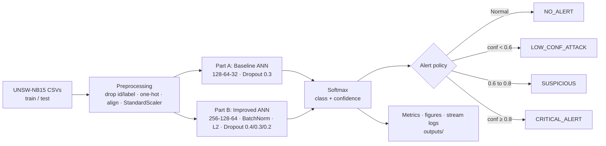

# ANN-Based Network Intrusion Detection (UNSW-NB15)

> PyTorch neural networks that classify network flows into 10 traffic classes and drive a confidence-gated, four-tier security alert system.


*Coursework for 6009CMD Artificial Neural Networks, Coventry University, 2025-26.*

---

## Overview

This project builds and compares two feed-forward ANNs for network intrusion detection on the
**UNSW-NB15** benchmark (Moustafa & Slay, 2015):

- **Part A — Baseline ANN** (128 → 64 → 32), designed independently by the student.
- **Part B — Improved ANN** (256 → 128 → 64 + BatchNorm + L2), produced through a
  Generative-AI-assisted design process as required by the module brief, with every suggestion
  critically evaluated before adoption.
- **Part C — Critical comparative reflection** (written report, not included in this repository).

Both models classify flows into **10 categories** (Normal + 9 attack types) and feed their softmax
confidence into an alert system that separates automatic blocking from cases that need a human analyst.
The evaluation goes beyond accuracy: it measures binary attack/normal performance, false-positive alert
volume (analyst fatigue) and missed attacks, and replays a 1,000-event stream to simulate live operation.

## Key features

- **Reproducible preprocessing pipeline** — one-hot encoding of `proto`, `service`, `state`; test schema
  aligned to train; `StandardScaler` fitted on train only (no leakage); fixed seed (`42`).
- **Two ANN architectures** sharing one configurable `ANN` module (hidden sizes, dropout, optional BatchNorm).
- **Robust training loop** — Adam, 15% validation split, `ReduceLROnPlateau`, early stopping
  (patience 5, max 50 epochs), per-epoch loss logs.
- **Multi-view evaluation** — multiclass report and confusion matrix, binary Normal-vs-Attack metrics
  (precision, recall, F1, FPR), confidence distributions for correct vs incorrect predictions.
- **Four-tier alert system** driven by prediction confidence:

  | Tier | Rule | Suggested action |
  |---|---|---|
  | `NO_ALERT` | predicted Normal | none |
  | `LOW_CONF_ATTACK` | attack, confidence < 0.6 | human review |
  | `SUSPICIOUS` | attack, 0.6 ≤ confidence < 0.8 | human review |
  | `CRITICAL_ALERT` | attack, confidence ≥ 0.8 | automated block / quarantine |

- **Streaming simulation** — 1,000 test flows replayed in random order with per-event logs.
- **Automatic artefact export** — figures, metric tables, stream logs, model weights and the fitted scaler.

## Architecture



| Component | Baseline (Part A) | Improved (Part B) |
|---|---|---|
| Hidden layers | 128 → 64 → 32 | 256 → 128 → 64 |
| BatchNorm | No | Yes (after each Linear) |
| Dropout | 0.3 / 0.3 / 0.0 | 0.4 / 0.3 / 0.2 |
| L2 regularisation | None | `weight_decay = 1e-4` |
| Learning rate | 1e-3 | 5e-4 |
| Batch size | 512 | 256 |

## Dataset

**UNSW-NB15** — Australian Centre for Cyber Security, 2015
- Training split: 82,332 records · Test split: 175,341 records · 45 columns
- 190 input features after one-hot encoding
- 10 classes: Normal, Fuzzers, Analysis, Backdoors, DoS, Exploits, Generic, Reconnaissance, Shellcode, Worms
- Severe class imbalance: 840× ratio between the largest and smallest class in training

The dataset is **not** included in this repository. Download it from
<https://research.unsw.edu.au/projects/unsw-nb15-dataset> and place the CSV files in `Dataset/`:

```
Dataset/
  UNSW_NB15_training-set.csv
  UNSW_NB15_testing-set.csv
```

## Results

Test-set results produced by the training scripts (written to `outputs/tables/metrics_baseline.csv`,
`outputs/tables/metrics_improved.csv` and `outputs/tables/comparison_summary.csv`):

| Metric | Part A Baseline | Part B Improved |
|---|---|---|
| Accuracy (10-class) | 0.7609 | 0.7525 |
| Macro-F1 | 0.4642 | 0.4492 |
| Weighted-F1 | 0.7290 | 0.7146 |
| Binary F1 | **0.8155** | 0.7802 |
| Binary Precision | 0.8934 | **0.9540** |
| Binary Recall | **0.7500** | 0.6600 |
| False-positive rate | 0.1346 | **0.0479** |
| False-positive alerts | 9,426 | **3,355 (−64%)** |
| Missed attacks (Attack → `NO_ALERT`) | **26,328 (25.0%)** | 35,812 (34.0%) |

**Takeaway:** a genuine precision/recall trade-off. The improved model cuts false-positive alerts by
64% (FPR 13.5% → 4.8%), reducing analyst fatigue, while the baseline catches more attacks and has the
higher binary F1 — showing that accuracy alone is not enough to judge an operational IDS.

## Tech stack

- **Language:** Python
- **Deep learning:** PyTorch (CPU)
- **ML / preprocessing:** scikit-learn (`StandardScaler`, metrics), NumPy, pandas, SciPy
- **Visualisation:** Matplotlib, seaborn
- **Persistence:** `torch.save` model weights, joblib scaler

## Getting started

```bash
# 1. Create and activate a virtual environment
python -m venv venv
source venv/bin/activate        # Linux/macOS
# venv\Scripts\activate         # Windows

# 2. Install dependencies
pip install -r requirements.txt

# 3. Download UNSW-NB15 into Dataset/ (see "Dataset" above)

# 4. Part A — baseline model (runs EDA, training, evaluation, stream simulation)
python -m src.part_a_human.train_baseline

# 5. Part B — improved model + baseline comparison
python -m src.part_b_genai.train_improved
```

Run both commands from the project root. Run Part A first: Part B loads Part A's metrics to build the
comparison table and chart.

`ids_ann.py` is a self-contained single-script version that trains and compares both models in one run
and prints all metrics to the console (no files written):

```bash
python ids_ann.py
```

### Generated outputs

All artefacts are written to `outputs/` (ignored by git):

| Folder | Contents |
|---|---|
| `figures/` | `eda_class_distribution.png`, `eda_imbalance_ratio.png`, `training_curves_{baseline,improved}.png`, `confusion_matrix_{baseline,improved}.png` (row-normalised), `confidence_distribution_{baseline,improved}.png`, `alert_distribution_{baseline,improved}.png`, `comparison_baseline_vs_improved.png` |
| `tables/` | `metrics_{baseline,improved}.csv`, `comparison_summary.csv`, `stream_log_{baseline,improved}.csv` (1,000-event streams) |
| `models/` | `baseline_model.pt`, `improved_model.pt`, `scaler.pkl` |
| `logs/` | `training_{baseline,improved}.csv` (train/val loss per epoch) |

## Project structure

```
.
├── ids_ann.py                     # Standalone end-to-end script (both models)
├── src/
│   ├── common/
│   │   ├── preprocessing.py       # Data loading + preprocessing pipeline
│   │   └── utils.py               # ANN module, training, evaluation, alerts, plots
│   ├── part_a_human/
│   │   └── train_baseline.py      # Part A: EDA + baseline model
│   └── part_b_genai/
│       └── train_improved.py      # Part B: improved model + comparison
├── Dataset/                       # UNSW-NB15 CSVs (not committed)
├── outputs/                       # Generated figures, tables, models, logs (not committed)
└── requirements.txt
```

## Reference

N. Moustafa and J. Slay, "UNSW-NB15: a comprehensive data set for network intrusion detection systems
(UNSW-NB15 network data set)," *Military Communications and Information Systems Conference (MilCIS)*, 2015.
